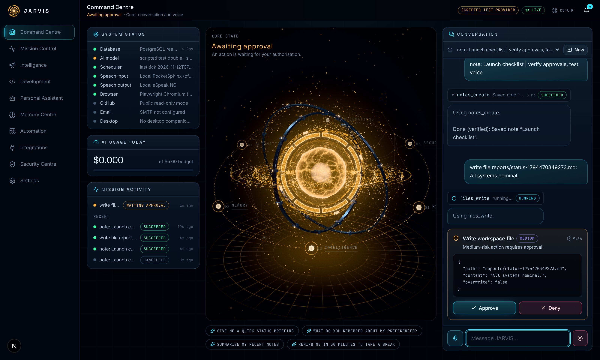

# JARVIS OS

A secure, voice-controlled personal AI operating environment: a cinematic real-time 3D command dashboard, an orchestrator that plans and executes tool calls under explicit permissions and approvals, long-term memory you control, scheduled automation, and a desktop companion whose native actions are enforced by a local Rust policy.

> **Beta.** What is verified, what is partial and what is deferred is tracked honestly in [docs/STATUS.md](docs/STATUS.md).



| | | |
|---|---|---|
|  |  |  |
| Idle | Thinking | Awaiting approval |
|  |  |  |
| Listening (mic-reactive) | Speaking (playback-reactive) | Error |

## What it does

- **Command Centre** — a procedural WebGL energy core whose nine visual states are derived only from real events (mic level, playback amplitude, running tools, pending approvals, run outcomes); streaming conversation with inline tool activity; push-to-talk voice.
- **Orchestrator** — Claude (official Anthropic SDK, `claude-opus-5-5` by default, automatic routing of simple requests to `claude-haiku-5-5`) or any OpenAI-compatible model; streaming, structured tool calls with validation, step and daily-cost budgets, cancellation, full execution traces.
- **Permissions & approvals** — every tool has a risk level and default policy; consequential actions pause for approval bound to the exact arguments; untrusted web content escalates later side effects to approval; one-click emergency stop.
- **27 tools** — notes, reminders, memory, research findings, email drafts/sending, sandboxed documents, web fetch and a headless browser (SSRF-guarded), Wikipedia, weather, GitHub (repo overview, PRs, CI, issues), and desktop actions.
- **Memory Centre** — proposed memories need your approval; conflict detection and supersession; private memories never reach the model; edit, expire or delete anything.
- **Automation** — DB-backed scheduler (cron or one-off), bounded multi-step workflows with dependencies and approval gates, daily-briefing and repo-health templates.
- **Everywhere** — installable PWA for phones (approvals, chat, voice, monitoring); Tauri 2 desktop companion for Windows/macOS/Linux.

## Quick start (local development)

Prerequisites: Node 22+, pnpm 10, Python 3.12+ with [uv](https://docs.astral.sh/uv/), PostgreSQL 16 with pgvector, and optionally `espeak-ng` (offline speech output) and `ffmpeg`.
If you use your own PostgreSQL instead of the compose file, a superuser must run `CREATE EXTENSION vector;` in the JARVIS database once (the migration needs it and ordinary roles cannot create it).

```bash
docker compose -f infrastructure/docker-compose.yml up -d postgres
```

```bash
cp .env.example .env
```

Edit `.env`: set `JARVIS_SETUP_TOKEN`, `JARVIS_SECRET_KEY` and `ANTHROPIC_API_KEY` (without a key, set `JARVIS_AI_PROVIDER=scripted` to explore with the deterministic test double).

```bash
pnpm install
```

```bash
cd apps/api && uv sync && uv run alembic upgrade head && uv run uvicorn jarvis.main:app --reload --port 8000
```

In a second terminal:

```bash
pnpm --filter @jarvis/web dev
```

Open http://localhost:3000, enter your setup token and create the owner account.

### Production-style single process

```bash
pnpm --filter @jarvis/web build
```

```bash
cd apps/api && JARVIS_ENV=production JARVIS_COOKIE_SECURE=true uv run uvicorn jarvis.main:app --host 127.0.0.1 --port 8000
```

FastAPI serves the static web export, the API and the WebSocket from one origin. Put it behind HTTPS (see `infrastructure/deployment/Caddyfile`). Do not expose it publicly without TLS, a strong password and a reviewed configuration.

### Desktop companion

See [apps/desktop/README.md](apps/desktop/README.md). The desktop app loads your JARVIS server, pairs with a one-time code, and executes only actions allowed by its local policy file.

## Tests

| Suite | Command | Current result |
|---|---|---|
| Backend (pytest, real PostgreSQL) | `cd apps/api && uv run pytest -q` | 94 passed, 1 live-network test skipped by default |
| Web unit (vitest) | `cd apps/web && npx vitest run` | 42 passed |
| End-to-end (Playwright, production build) | `npx playwright test -c tests/e2e/playwright.config.ts` | 15 passed |
| Desktop policy (cargo) | `cd apps/desktop/src-tauri && cargo test --workspace` | 60 passed |

CI (`.github/workflows/ci.yml`) runs all of these plus ruff, ESLint, type-checking, migration drift checks, `pnpm audit`, `pip-audit` and `cargo audit`.

## Documentation

- [Architecture](docs/ARCHITECTURE.md) · [Security model](docs/SECURITY.md) · [Status](docs/STATUS.md) · [Roadmap](docs/ROADMAP.md) · [Decisions](docs/DECISIONS.md) · [Design system](docs/DESIGN_SYSTEM.md)

## Credits

JARVIS OS grew out of the original *Virtual Personal Assistant using Python* by Ashutosh Krishna (MIT licensed), preserved in [`legacy/`](legacy/README.md). Its weather, Wikipedia and email capabilities were re-implemented as permission-checked tools.
